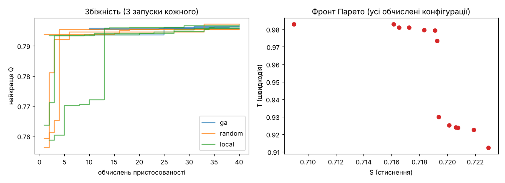

## 1. Розбір потоку: жадібний vs лінивий vs ДП (по групах корпусу)

Розмір = байти після LZ77+Гаффман (блоки по 16384 Б, без шифрування), час = розбір+кодування (c).

| група | сирий, Б | жадібний, Б / с | лінивий, Б / с | ДП, Б / с |
|---|---|---|---|---|
| природний текст | 46471 | 9641 / 0.04 | 9537 / 0.06 | 9180 / 0.51 |
| вихідний код | 68803 | 17690 / 0.06 | 16921 / 0.10 | 16303 / 0.70 |
| структуровані дані | 57452 | 23165 / 0.07 | 21818 / 0.11 | 20693 / 0.42 |
| растр без стиснення | 51109 | 7141 / 0.02 | 7141 / 0.02 | 7020 / 0.43 |
| виконуваний файл | 32768 | 17349 / 0.05 | 17550 / 0.07 | 17186 / 0.24 |
| вже стиснуте | 34789 | 34789 / 0.07 | 34789 / 0.07 | 34789 / 0.06 |
| штучні дані | 38511 | 20840 / 0.03 | 20840 / 0.03 | 20840 / 0.16 |
| **разом** | 329903 | **130615** | **128596** | **126011** |

## 2. Вплив кожного блоку на Q (корпус 21 файл, медіана з 3 запусків)

| конфігурація | архів, Б | коеф. | t, с | S | T | Q | томів |
|---|---|---|---|---|---|---|---|
| повна система (лінивий, ДП-рюкзак, перцептрон) | 129828 | 2.541 | 0.82 | 0.7176 | 0.9733 | **0.7943** | 2 |
| без перцептрона (усі файли як тип 6, без відмови для типу 5) | 129828 | 2.541 | 0.80 | 0.7176 | 0.9742 | **0.7946** | 2 |
| жадібний замість лінивого | 131968 | 2.500 | 0.71 | 0.7143 | 0.9767 | **0.7930** | 3 |
| ДП-розбір замість лінивого | 127222 | 2.593 | 3.14 | 0.7217 | 0.9054 | **0.7768** | 2 |
| жадібний рюкзак замість ДП-рюкзака | 129807 | 2.541 | 0.71 | 0.7176 | 0.9767 | **0.7954** | 2 |
| без стиснення (усе STORE) | 332311 | 0.993 | 0.17 | 0.4982 | 0.9943 | **0.6470** | 6 |
| без відмови від стиснення (поріг ∞) | 134201 | 2.458 | 0.97 | 0.7108 | 0.9686 | **0.7882** | 3 |

Опорний пакувальник викладача: 128968 Б (коеф. 2.558). Наш лінивий: 129828 Б; ДП: 127222 Б.

## 3. ДП проти жадібності на пакуванні першого тому

| max_volume | W | блоків | цінність ДП | цінність жадібний | різниця | відн. | час ДП, мс | час жадібн., мс |
|---|---|---|---|---|---|---|---|---|
| 65536 | 65025 | 32 | 615607 | 613564 | 2043 | 0.332% | 6.7 | 0.04 |
| 32768 | 32257 | 49 | 405199 | 399967 | 5232 | 1.291% | 3.3 | 0.03 |
| 16384 | 15873 | 92 | 182126 | 182126 | 0 | 0.000% | 2.8 | 0.04 |
| 8192 | 7681 | 171 | 79578 | 79578 | 0 | 0.000% | 2.7 | 0.07 |

Цінність блоку = пріоритет типу × (raw_len+1). ДП ≥ жадібного завжди (точний), жадібний вигравав у часі.

## 4. Порядок операцій: стиснути→зашифрувати vs зашифрувати→стиснути

| схема | розмір, Б | коеф. стиснення |
|---|---|---|
| сирі дані | 329903 | 1.000 |
| стиснути → зашифрувати (наша) | 128596 | 2.565 |
| зашифрувати → стиснути | 329903 | 1.000 |

AES-CTR дає шифртекст, статистично нерозрізнений від шуму (≈8 біт/байт); LZ77/Гаффман не знаходить повторів, тому блоки йдуть як STORE.

## 5. Ентропія по групах (чому «вже стиснуте» не стискається)

| група | ентропія, біт/байт | коеф. стиснення |
|---|---|---|
| природний текст | 4.014 | 4.96 |
| вихідний код | 4.331 | 4.06 |
| структуровані дані | 3.898 | 2.63 |
| растр без стиснення | 7.963 | 6.96 |
| виконуваний файл | 5.138 | 1.81 |
| вже стиснуте | 7.982 | 1.00 |
| штучні дані | 4.105 | 90.35 |

## 6. Класифікатор (перцептрон з нуля: 61→48→24→7, ReLU, softmax, Adam)

Ініціалізації (seed, F1 train, F1 valid): [(1, 1.0, 0.99), (2, 1.0, 0.96), (3, 1.0, 0.96)]; обрано seed=1 за macro-F1 на valid/.

**valid/**: macro-F1 = 0.9905 (F1_min = 0.61; випадковий вибір ≈ 0.1614)

| факт\прогноз | 0 | 1 | 2 | 3 | 4 | 5 | 6 |
|---|---|---|---|---|---|---|---|
| 0 | 15 | 0 | 0 | 0 | 0 | 0 | 0 |
| 1 | 0 | 15 | 0 | 0 | 0 | 0 | 0 |
| 2 | 0 | 0 | 15 | 0 | 0 | 0 | 0 |
| 3 | 0 | 0 | 0 | 15 | 0 | 0 | 0 |
| 4 | 0 | 0 | 0 | 0 | 15 | 0 | 0 |
| 5 | 0 | 0 | 0 | 0 | 0 | 15 | 0 |
| 6 | 0 | 0 | 0 | 1 | 0 | 0 | 14 |

**corpus/ (не бачений при навчанні)**: macro-F1 = 1.0000 (F1_min = 0.61; випадковий вибір ≈ 0.1614)

| факт\прогноз | 0 | 1 | 2 | 3 | 4 | 5 | 6 |
|---|---|---|---|---|---|---|---|
| 0 | 3 | 0 | 0 | 0 | 0 | 0 | 0 |
| 1 | 0 | 3 | 0 | 0 | 0 | 0 | 0 |
| 2 | 0 | 0 | 3 | 0 | 0 | 0 | 0 |
| 3 | 0 | 0 | 0 | 3 | 0 | 0 | 0 |
| 4 | 0 | 0 | 0 | 0 | 3 | 0 | 0 |
| 5 | 0 | 0 | 0 | 0 | 0 | 3 | 0 |
| 6 | 0 | 0 | 0 | 0 | 0 | 0 | 3 |

## 7. Збіжність ГА проти випадкового та локального пошуку (бюджет 40 обчислень пристосованості, 3 запуски)

| метод | Q за запусками | середнє | σ |
|---|---|---|---|
| ga | 0.7964 / 0.7957 / 0.7962 | 0.7961 | 0.0003 |
| random | 0.7956 / 0.7972 / 0.7955 | 0.7961 | 0.0008 |
| local | 0.7969 / 0.7962 / 0.7958 | 0.7963 | 0.0005 |

| запуск | найкраще gen 0 | найкраще остання gen | монотонно |
|---|---|---|---|
| 2001 | 0.7959 | 0.7964 | True |
| 2002 | 0.7954 | 0.7957 | True |
| 2003 | 0.7937 | 0.7962 | True |

Фронт Парето за (S, T):

| S | T | стратегія | depth | min_match | block | thr |
|---|---|---|---|---|---|---|
| 0.7229 | 0.9124 | 3 | 64 | 5 | 16384 | 0.9 |
| 0.7219 | 0.9226 | 3 | 32 | 5 | 16384 | 0.98 |
| 0.7207 | 0.9237 | 3 | 32 | 4 | 12288 | 0.95 |
| 0.7206 | 0.9239 | 3 | 32 | 4 | 16384 | 0.9 |
| 0.7201 | 0.9253 | 3 | 16 | 3 | 16384 | 0.9 |
| 0.7194 | 0.9298 | 3 | 16 | 4 | 12288 | 0.98 |
| 0.7192 | 0.9734 | 2 | 64 | 4 | 16384 | 0.9 |
| 0.7191 | 0.9794 | 2 | 32 | 4 | 16384 | 0.9 |
| 0.7183 | 0.9796 | 2 | 32 | 4 | 16384 | 0.9 |
| 0.7172 | 0.9811 | 1 | 32 | 5 | 16384 | 1.0 |
| 0.7165 | 0.9811 | 1 | 32 | 5 | 12288 | 1.0 |
| 0.7161 | 0.9828 | 1 | 32 | 4 | 16384 | 0.9 |
| 0.7090 | 0.9829 | 1 | 2 | 4 | 16384 | 0.9 |
